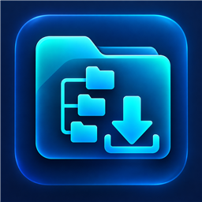

## Download

**[Download the Latest Version of FetchTree](https://github.com/duke2k1/FetchTree/releases/latest)**

Download the latest release for Windows from the GitHub Releases page.
# FetchTree v0.3

FetchTree is a Windows desktop browser for remote HTTP/HTTPS directory listings. It presents remote folders in a familiar Explorer-style layout, then lets you select files or folders and copy their contents to the Windows desktop or another Explorer window.

Developed by David Charnock.

An Explorer-style Windows desktop app for HTTP/HTTPS directory listings.

## Run

Extract the package and double-click **FetchTree.exe**. Requires Windows 10/11 and .NET Framework 4.8. No installation or extra packages are needed; the executable is unsigned. Windows Defender or SmartScreen may show an unsigned-app warning; use the copy from the release package you downloaded.

1. Enter a directory URL such as `https://example.com/files/` and click **Connect**.
2. Double-click folders or use the folder tree. Back, Up, Refresh, and Icon/Details views provide familiar navigation.
3. Select files and folders together using **Ctrl-click**, **Shift-click**, or **Ctrl+A**.
4. **Drag the selection to your desktop or a File Explorer folder.** Actual contents are copied, preserving nested and empty folders. Keep FetchTree open while the Windows copy operation is running.

When dragging outside FetchTree, the Windows copy dialog may appear. FetchTree returns to its own interface while the transfer continues, so you can keep browsing. The transfer queue shows remote download progress; Windows Explorer shows the final destination copy.

The navy/cyan header includes the app logo and developer credit: Developed by David Charnock. File, Edit, View, and Help menus are at the top. Back and Up sit beside the directory path. The Windows executable has its own embedded icon.

The queue shows file status and downloaded bytes. Choose 1–8 simultaneous downloads (default 3). Cancel stops scanning or transfers. File, Edit, View, and Help menus are available at the top; Back and Up are beside the current directory path.

## Folder transfers

Depth 0 reads the root listing; opening a folder loads it on demand. Higher depths preload more levels. Transferring a folder always resolves its full subtree independently of browsing depth. An incomplete scan fails rather than silently omitting files.

Folders are resolved when a drop target requests descriptors. Large selections may take time to prepare. File downloads begin when the target requests contents, not when items are selected. A target may request contents before mouse release; Explorer normally does so at the drop. Explorer negotiates asynchronous copying. Its progress window can remain visible while FetchTree returns to browsing; keep FetchTree open until copying finishes. A second transfer waits for the current transfer to finish.

Limits: 2,000 listing requests per selected folder, depth 100, and 10,000 total transfer entries. Browsing allows 1,000 pages and 10,000 entries per scan. Listing requests have a 20-second timeout and a 4 MB response limit. Downloads have a 60-second inactivity timeout.

Windows-incompatible names, case collisions, and relative transfer paths over 220 characters are rejected. Explorer handles destination conflicts during drops. Downloads are staged under `%TEMP%\FetchTree` and cleaned after transfers; crashes or external consumers holding streams open may leave cached files. Files are never executed.

## Supported sites and limitations

Supports Apache/nginx-style directory links and HTML folder-icon tables, including folder links without trailing slashes. Use the exact URL casing expected by the server. Parent, external, duplicate, query, and fragment links are excluded. Listing redirects may only normalize a trailing slash; file redirects are rejected. Enter the final directory URL.

JavaScript-generated listings, authentication, automatic retries, resume, signing, and an installer are not included. Inspect the destination after a cancelled or failed drop: Explorer may have copied only part of a selection. The queue reports downloaded bytes; Explorer controls the final destination copy.
